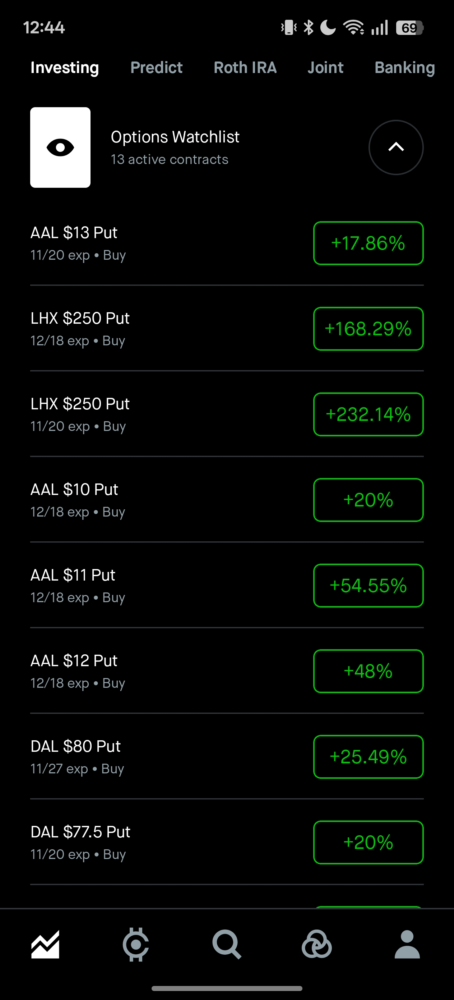

# Money 24 by DOGS

An AI that trades crypto, options, stocks, futures, prediction markets, and
forex, around the clock according to the news, signals, trackers, and AI analysis. The goal is entirely hands off.

**Status: very in development. we are not even closeto achieving this. The risks are enormous. And if this succeeds, the entire world's economy is donezo. Because the common people will have what the rich have had for centuries, the same money machines. Be afraid.**

**Realistically, I reckon my AI subscriptions should be getting at least a dollar out the market a day for me the way that thing swings. That's the goal. Connect your AI subscriptions to money24, hands off trading with brokerage API conenctions, loops and services and daemons.**

## Trading Philosophies

I have only ever lost money from the markets. But I see AI trading as my best shot at fixing that. The way this is gonna float is to tread lightly. Pins, needles, stop losses, gradual development. Trading, backtesting on collected data, and experimentation.

This repo is currently in heavy development, and I Brandon Dcruz am not liable for anything you do with it at this point in development. There's further terms at the bottom.

You can see some of the rules that have kept my day trading portfolio afloat here. I'm trying to set money24 up around 'Plays'. Essentially, a set entry, and set exits and stop losses, at set times for set prices. Like a targeted hit, all outcomes planned for in advance. Driven by your AI subscription, and local DOGS services (newsd: fetches articles from public sources, m24d: connects to your brokerage API and executes the trades, +more).

Picture this: On Friday November 13th the FAA ordered a full ground stop for all commercial airline flights, for 4 hours. They then had a press conference and instead of saying anything about the people who were impacted by this, they said they needed 50 billion dollars immediately.

That night I angrily tweeted. That morning, Saturday while markets were closed, I asked Google Gemini, 'give me the stocks most likely to be impacted by the only full FAA grounding since 9/11'. Immediately, it came back, LHX (L3 Harris, the contractor company that caused the outage), DAL (Delta Airlines), AAL (American Airlines), UAL (United Airlines), and more. I asked for Put option contracts with hightened trading volumes, people with the same idea as me (Put option aka shorting a company, betting it will go down, best when you know the company is about to quickly swiftly tank down, the faster the better. what, you didn't know companies stock hurting was a good thing? yes, it's very good. It's about velocity. If a stock goes up very swiftly (call options), or down very switfly (put options), you can profit. Or lose the entire investment, in seconds. Millions of corporations around the world rely on this way of trading, because regulation and trade economics, and taxes, are so bad. Hopefully we can teach about trading with money24 too.). Wham!



Like chess, like clockwork, money from the sky. Short window, and many things can go wrong. But money24 is aimed at trying to capture this, entirely hands off. And this is me prompting Gemini manually, we need to automate this. Across all the 6 markets of the 7 seas on God's green earth.

I won't lie. This is the riskiest form of trading there is. Even here, I traded these gains, but did not fund myself. I think this is doable. I've watched claude fable cook up a million lines of code in seconds. Yeah, even if money24 doesn't succeed, just like a gta6 fan port on pc, the ai money machine is inevitable. Because the money machine has always existed, just not for people.

Once this is complete we can assess an overall risk of money24 as a product. I need help though. If you're reading this, email brando@dogs.red immediately, and help me build man's holy grail. The hybrid car that drives itself. Open source.

I am currently collecting market data for backtesting, trading, polishing the UI, and orchestrating the new world order.

Heavy development. Do not disturb. Don't cut yourself on the glass sharp blades.

## Trading Rules

In my 3 years of experience as a trader, I find there's rules to this game that must be followed to be successful. This is a game of discipline, and actually, eliminating human emotion from the game should have very positive impacts here.

Every situation is different. And I want money24 to be customizable, so rules can be set for every situation. My general rules are below

- Stop losses are good. Few situations require time, patience, and trust without a stop loss.
- Exits are best planned in advance. Ladder exits work best when done right (sell orders, multiple profit targets for every trade planned in advance).
- Follow the whales. The big grift in trading is convincing inexperienced newcomers into betting, not deciding. Metrics including order volumes, moving averages, and more turn trading into less of a casino and more of a weatherman's game. Almost everything is predictable in this game if you act quick enough, and know where to look. Never trade alone, always make plays that other people are making too.

## What's in here

| Part | What it does | Where | Status |
|---|---|---|---|
| Landing / client (`src/`) | Svelte 5 + Vite + Tailwind v4 landing page, plus the live feed at `feed.html` | Cloudflare Pages · Tauri desktop | Live |
| `newsd` (`engine/cmd/newsd`) | Polls news, filings, central-bank, macro and Polymarket feeds; tags against the watchlist; stores in SQLite; streams over SSE | Desktop sidecar · Linux server | Running |
| `m24d` + signals (`engine/`) | The trading runner. The signals package reads callout sources (X, Telegram, wallets, webhooks), parses them and trades with our own exits | Same as `newsd` | Webhook runner; adapters next: [notes/trading-service.md](notes/trading-service.md) |

Everything server-side is one Go module in `engine/` (see
[docs/ARCHITECTURE.md](docs/ARCHITECTURE.md)). Each process keeps its own
SQLite database. Cloudflare is only the control plane, later on.

## Run it

**The whole app on your own machine:** install Node 22+ and Go 1.26+, then run `start.bat` (Windows)
or `./start.sh` (macOS, Linux). Full steps, settings and fixes: [docs/RUNNING.md](docs/RUNNING.md).

The sections below run one part at a time.

### Client

```sh
npm install
npm run dev          # http://localhost:5173  (feed: /feed.html)
npm run build        # production build into dist/
```

Pushes to `master` deploy https://money24.dogs.red.

### Docker: Windows, Linux or VPS (same command everywhere)

```sh
cp .env.example .env          # put a real contact email in USER_AGENT
docker compose up -d --build  # http://localhost:8024
docker compose logs -f news
docker compose down           # the news-data volume keeps the database
```

On Windows this needs Docker Desktop. This starts `news` (8024) and `trading` (8025).

### newsd: by hand (any OS)

```sh
cd engine
USER_AGENT="Money24-News/0.1 (DOGS; you@example.com)" go run ./cmd/newsd --data ./data
```

Then `npm run dev` and open http://localhost:5173/feed.html. The API is on
`127.0.0.1:8024`. **SEC and BLS reject requests until `USER_AGENT` includes
a contact email.**

### newsd: Windows desktop app

```sh
npm run desktop          # dev: Tauri starts newsd as a sidecar
npm run desktop:build    # installer
```

Data lives in `%AppData%\red.dogs.money24\news\news.db`.

### newsd: Linux VPS

```sh
npm run engine:linux                     # cross-compiles the binary
# copy it to the server, then install engine/deploy/newsd.service with systemd
sudo systemctl enable --now newsd
journalctl -u newsd -f                   # logs
```

On a server, set `NEWSD_ADMIN_TOKEN` and `NEWSD_HOSTS` (your domain behind
the reverse proxy). All flags are listed in [engine/README.md](engine/README.md).

### m24d: trading runner

Takes callouts on a webhook, plans each entry with its stop, ladder and time
exits, and writes every plan and rejection to its journal. It has
no broker code yet, so it can't place a real order. The UI is optional: the
runner works the same headless.

| Where | How |
|---|---|
| Windows desktop | `npm run desktop` starts `newsd` and `m24d` as sidecars. The window opens on News, and **Trading →** switches to the desk |
| Any OS, by hand | `cd engine && go run ./cmd/m24d --data ./data/trading`, then `npm run dev` → http://localhost:5173/trading.html |
| Linux server | `npm run engine:linux`, then `engine/deploy/m24d.service` under systemd (headless) |
| Docker | the `trading` service in `docker-compose.yml` (port 8025) |

The webhook secret comes from `M24D_WEBHOOK_SECRET`. Without it, a random
secret is generated once into `<data>/webhook-secret`.

```sh
curl -H "Authorization: Bearer $(cat engine/data/trading/webhook-secret)" \
  -d '{"source_id":"x:MATTSMATTED","text":"BTO $SPY 600C 11/21 @ 1.20"}' \
  http://127.0.0.1:8025/signals
```

| Route | Returns |
|---|---|
| `POST /signals` | parses a callout (Bearer secret required) and answers with how it was read |
| `GET /api/journal?limit=&after=` | recent journal entries, oldest first |
| `GET /api/stream?after=` | SSE: one message per new entry, with backfill by `Last-Event-ID` |
| `GET /api/sources` | the source catalog and default settings |
| `GET /healthz` | `ok` |

Tests: `cd engine && go test ./signals/`.

### Guardrails

- **Only.** The runner refuses to start if any key or endpoint looks
  live.
- Scraper accounts (X, Telegram) are burners, never personal accounts.
- Secrets go in environment variables or the host's secret store, never in git.

## Notes

Research and design live in [notes/](notes/README.md) and [docs/](docs/).


# MONEY24 TERMS OF SERVICE, RISK DISCLOSURE, AND WAIVER OF LIABILITY

**Effective Date:** [11/1/2026]  
**Operator:** [DOGS] ("Company," "we," "us," or "our")  
**Platform:** Money24 ("Service," "Software," or "Platform")

**PLEASE READ THIS AGREEMENT CAREFULLY. BY CHECKING THE ACCEPTANCE BOX, CLICKING "I AGREE," CREATING AN ACCOUNT, OR ACCESSING OR USING MONEY24, YOU ("USER" OR "YOU") AGREE TO BE LEGALLY BOUND BY ALL TERMS HEREIN. IF YOU DO NOT AGREE, DO NOT USE THE SERVICE.**

---

### 1. NO INVESTMENT ADVICE; SOFTWARE TOOL ONLY
1.1 **Not a Registered Adviser or Broker.** Company is a software technology provider, not a registered investment adviser, broker-dealer, commodity trading advisor, financial planner, or fiduciary under the U.S. Investment Advisers Act of 1940, the Securities Exchange Act of 1934, the Commodity Exchange Act, or any state securities laws.  
1.2 **Impersonal Software Output Only.** Money24 provides automated algorithmic software tools, market data visualizations, and user-configured execution scripts. **NOTHING ON OR GENERATED BY MONEY24 CONSTITUTES FINANCIAL, INVESTMENT, TRADING, TAX, OR LEGAL ADVICE, NOR A RECOMMENDATION OR SOLICITATION TO BUY, SELL, OR HOLD ANY SECURITY, OPTION, CRYPTOCURRENCY, OR FINANCIAL INSTRUMENT.**  
1.3 **Sole User Responsibility.** All algorithmic outputs, signals, backtests, and automated executions are impersonal and generated without regard to your individual financial situation, risk tolerance, or investment objectives. You retain sole and exclusive control over your brokerage accounts, API keys, parameter configurations, and capital allocation.

### 2. SUBSTANTIAL RISK OF LOSS ACKNOWLEDGMENT
You expressly acknowledge, understand, and accept the following risks:
* **Total Loss of Capital:** Trading equities, options, futures, digital assets, and leveraged instruments carries an extreme degree of risk. You may lose some or all of your invested capital, and in certain strategies (such as short sales or uncovered options), losses may exceed your initial deposit.
* **Algorithmic & Technical Failure:** Automated trading software is subject to software bugs, logic errors, latency, slippage, API disconnections, third-party brokerage outages, corrupted market data feeds, and catastrophic market gaps ("flash crashes") where stop-loss orders fail to execute at expected prices.
* **Past Performance:** Historical backtests, simulated results, and prior algorithmic performance do not guarantee or predict future results. Hypothetical performance has inherent limitations and does not reflect actual liquidity constraints or emotional/operational execution risks.

### 3. DISCLAIMER OF WARRANTIES ("AS IS")
THE SERVICE IS PROVIDED ON AN **"AS IS"** AND **"AS AVAILABLE"** BASIS WITHOUT WARRANTIES OF ANY KIND, EITHER EXPRESS OR IMPLIED. TO THE MAXIMUM EXTENT PERMITTED BY APPLICABLE LAW, COMPANY EXPRESSLY DISCLAIMS ALL WARRANTIES, INCLUDING IMPLIED WARRANTIES OF MERCHANTABILITY, FITNESS FOR A PARTICULAR PURPOSE, TITLE, NON-INFRINGEMENT, ACCURACY OF DATA, UPTIME, OR PROFITABILITY.

### 4. COMPLETE WAIVER OF FINANCIAL RESPONSIBILITY & LIMITATION OF LIABILITY
4.1 **No Financial Responsibility for Trading Losses.** TO THE FULLEST EXTENT PERMITTED BY LAW, COMPANY AND ITS FOUNDERS, OFFICERS, DIRECTORS, DEVELOPERS, AFFILIATES, AND AGENTS SHALL HAVE **ZERO FINANCIAL RESPONSIBILITY OR LIABILITY** FOR ANY TRADING LOSSES, LOST PROFITS, MARGIN CALLS, ACCOUNT LIQUIDATIONS, MISSED TRADES, ERRONEOUS EXECUTIONS, OR DIMINUTION OF VALUE ARISING OUT OF OR RELATING TO YOUR USE OF MONEY24.  
4.2 **Exclusion of Consequential Damages.** IN NO EVENT SHALL COMPANY BE LIABLE FOR ANY INDIRECT, INCIDENTAL, SPECIAL, CONSEQUENTIAL, EXEMPLARY, OR PUNITIVE DAMAGES, EVEN IF ADVISED OF THE POSSIBILITY OF SUCH DAMAGES.  
4.3 **Maximum Liability Cap.** IN ALL CIRCUMSTANCES, COMPANY'S TOTAL AGGREGATE LIABILITY ARISING OUT OF OR RELATING TO THIS AGREEMENT OR THE SERVICE SHALL NOT EXCEED THE GREATER OF: (A) THE TOTAL FEES PAID BY YOU TO COMPANY FOR THE SERVICE IN THE THREE (3) MONTHS PRECEDING THE CLAIM, OR (B) ONE HUNDRED U.S. DOLLARS ($100.00).

### 5. INDEMNIFICATION
You agree to defend, indemnify, and hold harmless Company and its founders, officers, employees, and affiliates from and against any and all claims, damages, losses, liabilities, regulatory inquiries, costs, and reasonable attorneys' fees arising out of or related to: (a) your trading activities or automated executions; (b) your violation of this Agreement or any applicable law or exchange rule; or (c) any dispute between you and a third-party broker or exchange.

### 6. BINDING ARBITRATION AND CLASS ACTION WAIVER
6.1 **Mandatory Individual Arbitration.** Any dispute, claim, or controversy arising out of or relating to this Agreement or Money24 shall be resolved exclusively through final and binding individual arbitration administered by the American Arbitration Association (AAA) under its Commercial Arbitration Rules, rather than in court.  
6.2 **Class Action & Jury Trial Waiver.** YOU AND COMPANY WAIVE ANY RIGHT TO A JURY TRIAL OR TO PARTICIPATE IN A CLASS ACTION, COLLECTIVE ACTION, OR REPRESENTATIVE PROCEEDING. All claims must be brought solely in your individual capacity.

### 7. GOVERNING LAW AND SEVERABILITY
This Agreement shall be governed by and construed in accordance with the laws of the State of Texas, without regard to conflict-of-law principles, with exclusive venue for any permitted court proceedings in Dallas County, Texas. If any provision of this Agreement is held unenforceable, the remaining provisions shall remain in full force and effect.